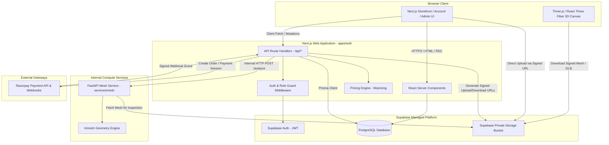
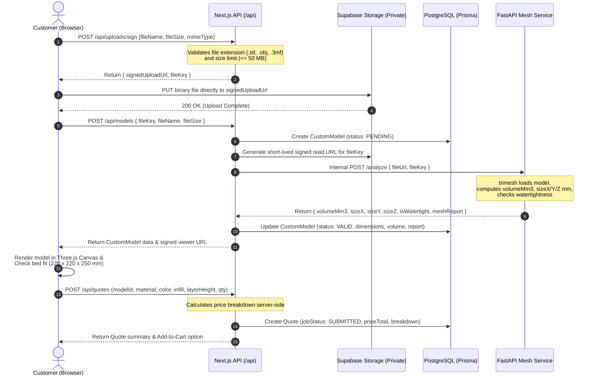

# ARCHITECTURE.md: System Architecture & Data Flow

> **Status**: Technical Reference & Architectural Blueprint  
> **Source of Truth**: [SPEC.md](file:///c:/Users/abhay%20mishra/Downloads/3D_website/SPEC.md) (Product Specifications)  
> **Operational Guide**: [AGENTS.md](file:///c:/Users/abhay%20mishra/Downloads/3D_website/AGENTS.md)

---

## 1. System Overview

The **3D Print Store** platform enables e-commerce sales of catalog 3D models and an interactive custom 3D model upload, analysis, quoting, and manufacturing pipeline.

The architecture decouples client-side 3D visualization, application business logic, relational storage, private binary file hosting, and computationally heavy 3D mesh analysis into distinct, well-bounded components.

---

## 2. Core Services & Component Responsibilities

| Service | Technology | Primary Responsibilities | Milestone Introduced |
|---|---|---|---|
| **Web Application** | Next.js 14+ (App Router), TypeScript, Tailwind CSS | Storefront, product catalog, cart state, interactive 3D viewer (React Three Fiber), customer accounts, admin dashboard, server route handlers (`/api/*`). | **M0 / M1** |
| **Relational Database** | PostgreSQL hosted on Supabase, managed via Prisma ORM | Persistent storage for users, addresses, products, custom models, quotes, orders, and order items. Enforces referential integrity. | **M0** |
| **Authentication** | Supabase Auth (Email + Password; Google OAuth optional) | User identity, session tokens, JWT issuance, and role attribution (`CUSTOMER` vs `ADMIN`). | **M1** |
| **Object Storage** | Supabase Storage (Private S3-compatible bucket) | Secure binary storage for uploaded custom 3D models (`.stl`, `.obj`, `.3mf`) and catalog preview assets (`.glb`). Direct browser upload via pre-signed URLs. | **M2** |
| **Mesh Analysis Service** | Python 3.10+, FastAPI, `trimesh`, `numpy` | Headless, isolated geometric analysis service: calculates bounding box (X, Y, Z mm), volume (mm³), surface area, and watertight/manifold diagnostics. | **M2** |
| **Payment Gateway** | Razorpay (Hosted Checkout & Webhooks) | Secure INR payment collection, transaction signature verification, and idempotent webhook processing to trigger production order states. | **M3** |
| **Transactional Email** | Resend *(Deferred)* | Automated email notifications for account verification, custom job quote updates, and order status transitions (`PAID`, `SHIPPED`). | Post-MVP / M3+ |

---

## 3. High-Level System Architecture Diagram



---

## 4. Custom Model Upload & Analysis Workflow

Custom uploads adhere to a strict direct-to-storage architecture to prevent large file uploads (up to 50 MB) from bottlenecking the Next.js server runtime or exceeding serverless execution limits.



---

## 5. Repository Structure

The codebase is organized as follows:

```
/
├── apps/
│   └── web/
│       ├── app/
│       │   ├── (storefront)/
│       │   │   ├── page.tsx               # Storefront homepage with featured 3D items
│       │   │   ├── catalog/page.tsx       # Filterable product catalog
│       │   │   ├── catalog/[slug]/page.tsx# Product detail with interactive 3D viewer
│       │   │   ├── custom-print/page.tsx  # Upload model, 3D preview & instant quote form
│       │   │   └── cart/page.tsx          # Shopping cart overview
│       │   ├── (auth)/
│       │   │   ├── login/page.tsx         # Supabase Auth sign-in
│       │   │   ├── register/page.tsx      # Sign-up form
│       │   │   └── reset-password/page.tsx# Password reset
│       │   ├── (account)/
│       │   │   └── orders/page.tsx        # Customer order history & model status
│       │   ├── (admin)/
│       │   │   ├── admin/products/        # Catalog product CRUD management
│       │   │   ├── admin/jobs/            # Custom 3D print review queue & approvals
│       │   │   └── admin/orders/          # Order fulfillment & status updates
│       │   └── api/
│       │       ├── products/              # GET /api/products, GET /api/products/[slug]
│       │       ├── uploads/sign/          # POST /api/uploads/sign (signed URL generation)
│       │       ├── models/                # POST /api/models, GET /api/models/[id]
│       │       ├── quotes/                # POST /api/quotes
│       │       ├── checkout/              # POST /api/checkout (M3)
│       │       ├── webhooks/payment/      # POST /api/webhooks/payment (M3)
│       │       └── admin/                 # Protected admin management endpoints (M4)
│       ├── components/
│       │   ├── ui/                        # Button, Card, Badge, Dialog, Form primitives
│       │   ├── viewer/
│       │   │   ├── ThreeCanvas.tsx        # Dynamic R3F Canvas container (SSR disabled)
│       │   │   ├── ModelStage.tsx         # Lighting, shadows, ground grid, camera controls
│       │   │   ├── STLLoaderView.tsx      # STL mesh rendering & wireframe overlay
│       │   │   └── BuildVolumeBox.tsx     # 220x220x250 mm visual boundary box
│       │   ├── catalog/                   # ProductCard, CategoryFilter, MaterialSelector
│       │   ├── custom/                    # UploadDropzone, QuoteSummary, FitWarningBanner
│       │   └── admin/                     # JobReviewCard, MeshDiagnosticsTable
│       ├── lib/
│       │   ├── supabase/                  # Browser, Server, and Service-Role clients
│       │   ├── prisma.ts                  # Prisma client singleton
│       │   ├── pricing/
│       │   │   ├── config.ts              # Material rates (PLA, PETG), machine hour costs
│       │   │   └── calculator.ts          # Section 7 pricing formula implementation
│       │   └── mesh-service/              # Client to call internal FastAPI service
│       └── prisma/
│           ├── schema.prisma              # Data model matching SPEC.md Section 6
│           └── seed.ts                    # Sample products with 3D models for local testing
├── services/
│   └── mesh/
│       ├── app/
│       │   ├── main.py                    # FastAPI application initialization & routes
│       │   ├── analyzer.py                # trimesh processing, watertight check, volume math
│       │   └── schemas.py                 # Pydantic request/response schemas
│       ├── tests/
│       │   ├── test_analyzer.py           # Unit tests with sample manifold/non-manifold STLs
│       │   └── test_api.py                # Endpoint integration tests
│       ├── Dockerfile                     # Container definition for Python runtime
│       └── requirements.txt               # fastapi, uvicorn, trimesh, numpy, scipy
├── docs/                                  # Project specifications & architecture manuals
├── tests/                                 # End-to-end integration tests (Playwright)
├── AGENTS.md                              # Agent operating instructions
├── SPEC.md                                # Canonical project specification
└── ARCHITECTURE.md                        # This document
```

---

## 6. Service Phasing Across Milestones

To ensure high development velocity and avoid premature operational overhead, service dependencies are phased:

### Phase 1: Milestones M0 & M1 (Foundation & Storefront MVP)
- **Active Components**: Next.js App, Supabase Database (PostgreSQL via Prisma), Supabase Auth.
- **Mock/Static Storage**: Catalog preview assets served from static public paths or test bucket.
- **Mesh Service**: Inactive in M0/M1; custom model upload is deferred until M2.
- **Payment Gateway**: Inactive in M0/M1; checkout is deferred until M3.

### Phase 2: Milestone M2 (Custom Model Upload & Quoting)
- **Active Components**: Supabase Storage (private bucket + signed URLs), FastAPI + `trimesh` mesh analysis service, client-side React Three Fiber STL/OBJ loader with build volume checking.
- **Pricing Engine**: Active server-side in Next.js using configured rates.

### Phase 3: Milestone M3 (Checkout & Payments)
- **Active Components**: Razorpay checkout integration and signed webhook receiver.
- **Order Pipeline**: Automatic order creation in `PENDING_PAYMENT` advancing to `PAID` via webhook.

### Phase 4: Milestone M4 (Admin Backoffice)
- **Active Components**: Admin review queue requiring manual admin approval for every custom print job before production.
