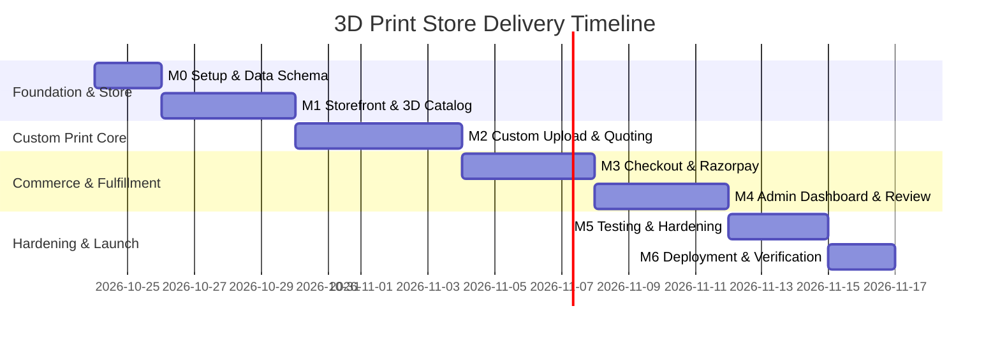

# IMPLEMENTATION_PLAN.md: Phased Delivery Roadmap (M0 - M6)

> **Status**: Active Project Roadmap  
> **Source of Truth**: [SPEC.md](file:///c:/Users/abhay%20mishra/Downloads/3D_website/SPEC.md) (Section 12)  
> **Execution Strategy**: Iterative, milestone-gated delivery. No milestone may begin until the preceding milestone satisfies its Definition of Done (DoD).

---

## Roadmap Overview

---

## Milestone M0: Setup & Development Foundation

### Objectives
Establish the monorepo workspace, configure TypeScript, Tailwind CSS, Prisma ORM, Supabase connection, and base development scripts.

### Tasks & Work Breakdown
1. **Repository Layout**:
   - Create directories: `/apps/web`, `/services/mesh`, `/docs`, `/tests`.
2. **Next.js Web Initialization (`apps/web`)**:
   - Initialize Next.js 14+ (App Router) with TypeScript, ESLint, and Tailwind CSS.
   - Configure `@/` path aliases in `tsconfig.json`.
3. **Database & ORM Configuration**:
   - Configure `prisma/schema.prisma` with the complete data model from `SPEC.md` Section 6:
     - Enums: `Role`, `ModelStatus`, `JobStatus`, `OrderStatus`.
     - Models: `User`, `Address`, `Product`, `CustomModel`, `Quote`, `Order`, `OrderItem`.
     - Constraint: Enforce that `OrderItem` references either `productId` OR `quoteId`.
   - Setup Supabase Postgres connection string in `.env.example`.
4. **Tooling & Scripts**:
   - Root `package.json` with scripts for `dev`, `build`, `lint`, and `test`.

### Dependencies
- Supabase Project URL and Database Connection String (`DATABASE_URL`).

### Acceptance Criteria & Definition of Done (DoD)
- [ ] Running `npm run build` in `apps/web` succeeds without errors.
- [ ] Running `npx prisma validate` confirms schema validity.
- [ ] Environment variable template (`.env.example`) documents all required keys without secrets.
- [ ] No application code or mock data exists outside the foundation scaffolding.

---

## Milestone M1: Storefront, 3D Catalog, Auth & Cart

### Objectives
Deliver the customer-facing catalog, interactive 3D model viewer for products, Supabase authentication, and local shopping cart.

### Tasks & Work Breakdown
1. **Supabase Auth Integration**:
   - Wire Supabase Auth client (`@supabase/ssr` / `@supabase/supabase-js`).
   - Create sign-up, login, and logout UI components (`/login`, `/register`).
   - Implement route middleware protecting `/account/*` and `/admin/*`.
2. **Product Catalog (`/catalog`)**:
   - Create seed script with sample 3D printable catalog items (name, description, price in INR, materials: PLA, PETG).
   - Category filtering and responsive grid layout according to [UI_UX_GUIDELINES.md](file:///c:/Users/abhay%20mishra/Downloads/3D_website/UI_UX_GUIDELINES.md).
3. **Interactive 3D Viewer (`ThreeCanvas.tsx`)**:
   - Setup React Three Fiber (`@react-three/fiber`, `@react-three/drei`).
   - Dynamic client-only import (`ssr: false`) with orbit controls, studio lighting, and smooth rotation.
   - Support rendering product `.glb` / `.stl` preview models.
4. **Product Detail Page (`/catalog/[slug]`)**:
   - Detailed product view with 3D canvas, material selector (PLA / PETG), and color selection.
   - Stock and price display in INR (`₹`).
5. **Shopping Cart**:
   - Client-side cart state (Zustand or React Context with local storage persistence).
   - Cart slide-over drawer / `/cart` page with item removal, quantity adjustment, and subtotal calculation.

### Dependencies
- Completion of M0.
- Sample 3D assets (`.glb` / `.stl`) for catalog seed data.

### Acceptance Criteria & Definition of Done (DoD)
- [ ] A visitor can browse products, view details, rotate a 3D model in the browser, and add items to the cart.
- [ ] Users can sign up, log in, and log out with Supabase Auth.
- [ ] Unauthenticated users are redirected when accessing `/account/orders`.
- [ ] Storefront renders responsively across desktop and mobile screens.

---

## Milestone M2: Custom Model Upload, Mesh Analysis & Quoting

### Objectives
Allow users to upload custom 3D files (`.stl`, `.obj`, `.3mf`), run geometric analysis via FastAPI + `trimesh`, inspect the model on a simulated $220 \times 220 \times 250\text{ mm}$ print bed, and receive an instant price quote.

### Tasks & Work Breakdown
1. **Supabase Storage Setup**:
   - Configure private storage bucket (`models`) with pre-signed upload URL generator (`/api/uploads/sign`).
   - Restrict extensions to `.stl`, `.obj`, `.3mf` and maximum size to $50\text{ MB}$.
2. **FastAPI Mesh Analysis Service (`/services/mesh`)**:
   - Scaffold FastAPI application with `POST /analyze`.
   - Implement `trimesh` geometry analyzer:
     - Volume computation in $\text{mm}^3$ and $\text{cm}^3$.
     - Bounding box dimensions ($X, Y, Z$ mm).
     - Watertight / manifold check:
       - **Watertight**: Return status `VALID`.
       - **Non-watertight**: Return status `VALID` with warning flag in `meshReport`.
       - **Corrupt / Empty**: Return status `INVALID` and clear error description.
   - Unit tests using pytest with sample valid, non-watertight, and corrupt meshes.
3. **Interactive Custom 3D Stage**:
   - Drag-and-drop file upload zone with upload progress feedback.
   - Render uploaded mesh on a simulated **$220 \times 220 \times 250\text{ mm}$** printer bed.
   - Show dimensional badge ($X, Y, Z$ mm) and warn visually if model exceeds printer bed boundaries.
4. **Deterministic Pricing Engine (`lib/pricing/calculator.ts`)**:
   - Implement Section 7 pricing formula:
     $$\text{material\_cost} = \text{volume\_cm3} \times \text{infill\_factor} \times \text{density\_g\_per\_cm3} \times \text{cost\_per\_gram}$$
     $$\text{machine\_cost} = \text{estimated\_print\_hours} \times \text{machine\_rate\_per\_hour}$$
     $$\text{subtotal} = \text{material\_cost} + \text{machine\_cost} + \text{setup\_fee}$$
     $$\text{price} = \max(\text{minimum\_order\_price}, \text{subtotal} \times (1 + \text{margin\_pct})) \times \text{quantity}$$
   - Config file (`lib/pricing/config.ts`) with configurable parameters for PLA & PETG.
5. **Quote API & Cart Integration**:
   - `/api/quotes` creates a `Quote` record linked to `CustomModel`.
   - Custom quotes can be added to the cart as distinct line items.

### Dependencies
- Completion of M1.
- Python 3.10+ runtime and `trimesh` dependencies installed for mesh service.

### Acceptance Criteria & Definition of Done (DoD)
- [ ] An STL file under 50 MB uploads directly to storage and renders in the 3D viewer.
- [ ] Non-watertight meshes display a clear warning banner without hard-blocking the quote.
- [ ] Corrupt or empty files are rejected with a clear user error message.
- [ ] Volume and bounding box values match `trimesh` reference output within 1%.
- [ ] Changing material, infill, or layer height dynamically updates the price breakdown in INR without page reload.
- [ ] Unit tests for pricing logic pass 100% of cases (minimum order threshold, volume scaling, margins).

---

## Milestone M3: Checkout, Razorpay Integration & Order Creation

### Objectives
Enable customers to checkout their cart, process INR payments via Razorpay hosted checkout, handle payment webhooks idempotently, and record paid orders.

> *Note: Transactional emails via Resend are deferred until after prototype verification.*

### Tasks & Work Breakdown
1. **Checkout UI (`/checkout`)**:
   - Address collection form (persisted to `Address` table).
   - Order summary displaying line items, shipping rate, tax, and total in INR (`₹`).
2. **Server-Side Validation**:
   - `/api/checkout` validates inventory for catalog items and recalculates quotes server-side.
   - Creates `Order` in database with status `PENDING_PAYMENT`.
3. **Razorpay Integration**:
   - Generate Razorpay Order ID and return credentials for hosted checkout modal.
4. **Payment Webhook Handler (`/api/webhooks/payment`)**:
   - Verify Razorpay HMAC-SHA256 signature using `PAYMENT_WEBHOOK_SECRET`.
   - Update `Order.status` to `PAID` and store `paymentRef`.
   - Enforce idempotency: multiple identical webhook events do not duplicate records or fire duplicate transitions.
5. **Order Confirmation Page (`/order-success/[id]`)**:
   - Summary view for customer showing order status and details.

### Dependencies
- Completion of M2.
- Razorpay API Test Keys (`RAZORPAY_KEY_ID`, `RAZORPAY_KEY_SECRET`, `PAYMENT_WEBHOOK_SECRET`).

### Acceptance Criteria & Definition of Done (DoD)
- [ ] Client cannot manipulate final total: server recomputes prices at checkout.
- [ ] Test payment updates order status from `PENDING_PAYMENT` to `PAID`.
- [ ] Simulated duplicate webhook deliveries result in exactly one `PAID` order record.
- [ ] Orders correctly link to catalog products or custom quotes.

---

## Milestone M4: Admin Dashboard & Custom Job Review

### Objectives
Provide store operators with tools to manage catalog products, inspect custom 3D uploads, and approve or reject custom print jobs before production.

### Tasks & Work Breakdown
1. **Admin Authorization Guard**:
   - Secure all `/admin/*` routes to accounts with `Role.ADMIN`.
2. **Catalog Product Management (`/admin/products`)**:
   - CRUD interface for catalog items: title, description, price, stock, active status, image URLs, model URLs.
3. **Custom Job Review Queue (`/admin/jobs`)**:
   - Table of custom print jobs with `JobStatus` (`SUBMITTED`, `APPROVED`, `REJECTED`).
   - Detailed inspection drawer:
     - 3D interactive viewer to inspect the customer's uploaded mesh.
     - Diagnostic readout: Volume, bounding box, watertight status, infill, layer height.
     - Action buttons: `Approve Job` or `Reject Job` (with mandatory reason note).
4. **Order Management (`/admin/orders`)**:
   - View all customer orders.
   - Update fulfillment lifecycle: `PAID` $\rightarrow$ `IN_PRODUCTION` $\rightarrow$ `SHIPPED` $\rightarrow$ `DELIVERED` (or `CANCELLED`).

### Dependencies
- Completion of M3.
- Admin user account seeded in database.

### Acceptance Criteria & Definition of Done (DoD)
- [ ] Non-admin users are blocked with 403 Forbidden when accessing `/admin/*`.
- [ ] Admin can view custom uploaded meshes in 3D and approve/reject them.
- [ ] Admin can update order status across the full manufacturing lifecycle.

---

## Milestone M5: Hardening, Automated Testing & Accessibility

### Objectives
Ensure production readiness through automated end-to-end tests, security audits, mobile viewport validation, and accessibility compliance.

### Tasks & Work Breakdown
1. **Automated Unit & Integration Tests**:
   - Vitest suite for pricing calculations, quote expiry, and webhook idempotency.
   - Pytest suite for FastAPI mesh analysis edge cases (zero volume, non-manifold, oversized meshes).
2. **End-to-End Tests (Playwright)**:
   - Guest browses catalog $\rightarrow$ adds to cart $\rightarrow$ proceeds to checkout.
   - Customer uploads STL $\rightarrow$ configures material $\rightarrow$ generates valid quote.
3. **Security & Input Hardening**:
   - Verify rate limiting on upload pre-signing and auth routes.
   - Confirm storage signed URLs expire within 15 minutes.
   - Verify no secrets leak in client JavaScript bundles.
4. **Accessibility & Responsive Polish**:
   - Keyboard accessibility verification for all interactive forms and dialogs.
   - Touch interaction testing for 3D viewers on mobile devices.

### Dependencies
- Completion of M4.

### Acceptance Criteria & Definition of Done (DoD)
- [ ] 100% of pricing and webhook unit tests pass.
- [ ] End-to-end Playwright tests execute successfully in CI.
- [ ] Zero critical or high severity vulnerabilities in `npm audit`.
- [ ] Mobile navigation and 3D viewers operate without scroll trapping or layout breaks.

---

## Milestone M6: Deployment & Launch Verification

### Objectives
Deploy the web application to Vercel and the FastAPI mesh service to a containerized host, verify environment configurations, and execute end-to-end test purchases.

### Tasks & Work Breakdown
1. **Infrastructure Provisioning**:
   - Production Next.js deployment on Vercel.
   - Production FastAPI deployment (Docker on Fly.io, Railway, or AWS ECS).
   - Production Supabase database, auth, and private storage bucket.
2. **Environment Configuration**:
   - Set production environment variables across web and mesh services.
   - Configure custom domain and SSL certificates.
3. **Smoke Testing**:
   - Execute a complete live checkout transaction using Razorpay test mode.
   - Verify direct upload and mesh analysis against production storage.

### Dependencies
- Completion of M5.
- Production hosting credentials and domain DNS access.

### Acceptance Criteria & Definition of Done (DoD)
- [ ] Web application and mesh service are live with active health checks.
- [ ] End-to-end user journey works in production without console errors.
